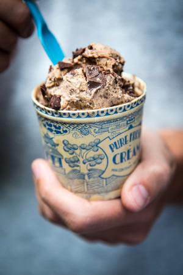

# 3-Ingredient Banana Ice Cream

## Ingredients

- 4 frozen bananas
- 3 tbsp smooth peanut butter
- 75g good-quality dark chocolate, chopped in rough chunks

## Instructions

1. Remove the bananas from the freezer and allow to defrost for 15 minutes.
2. Place the bananas and peanut butter in a food processor and blend for about 2 minutes until smooth and creamy. The mixture will start off crumbly but stop and start the processor a few times, scraping down the sides in between and you will be left with some creamy magic!
3. Transfer the ice cream to a bowl and use a spatula to fold through the dark chocolate chunks. Serve straight away with extra chocolate sprinkled over the top or cover and freeze until needed. This will keep in the freezer for 1 month.
