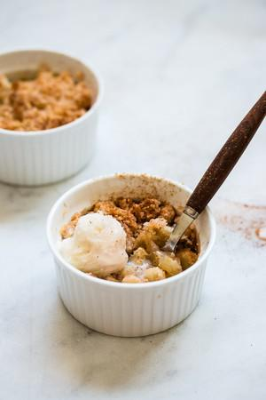

# 5-Ingredient Individual Apple Crumble

## Ingredients

### Filling
- 1 apple , peeled, cored, and sliced into small cubes
- 1 tablespoon granulated sugar
- ¼ teaspoon ground cinnamon

### Streusel Topping
- 3 ½ tablespoons (30 g) all-purpose flour
- 2 tablespoons (25g) granulated sugar
- 2 tablespoons (30g) unsalted butter, melted
- optional – 1 ½ tablespoons old-fashioned oats , chopped pecans or walnuts

## Instructions

1. Preheat oven to 350F/180C.
2. To make the apple filling: In a small bowl, toss apples with sugar and cinnamon. Divide apples into 2 individual ramekins, and press them slightly. Set aside.
3. To make the topping: Mix flour and sugar, then add melted butter. Mix with a fork, until mixture clumps together into crumbly balls. Mix in oats and nuts, if using. Sprinkle crumble evenly on top of the apple mixture.
4. Bake for about 30 minutes, until topping is golden brown and apples are tender. Serve warm and top with ice cream if you want (how can you not want?).
