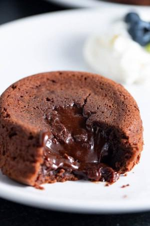

# Air Fryer Chocolate Molten Lava Cakes

## Ingredients

- 3 Tablespoon unsalted butter cut into pieces
- 2 oz (60g) semi-sweet chocolate bar broken into pieces
- 1 medium egg
- 1.5 Tablespoons white sugar
- ¼ teaspoon vanilla extract
- 1.5 Tablespoons all-purpose flour
- pinch of salt

### Equipment
- Air Fryer
- 2 Muffin formen

## Instructions

1. Melt butter and chocolate in a microwave-safe bowl in for about 1 minute until melted, stirring every 30 seconds. Set aside.
2. In a separate large bowl, use an electric beater and beat egg, egg yolk, vanilla extract, and sugar together until well blended.
3. Then add flour, the chocolate mixture, and a pinch of salt and stir until combined. Pour the mixture into the ramekins, filling each one about halfway.
4. Place in the air fryer basket and air fry on 370 degrees Fahrenheit for 8-10 minutes.
5. Once done air frying, use a clean thick dish towel to remove ramekins from the air fryer basket. Allow cake to cool in a ramekin for about 1 minute. Use a butter knife to loosen the cake from the ramekin and turn over onto a plate. Serve with fresh whipped cream, fresh berries, or topped with powdered sugar and enjoy.
