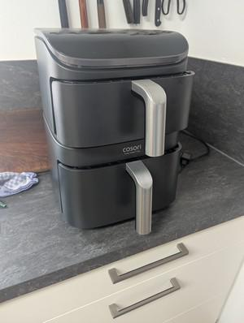

# Airfryer Zeiten

## Ingredients

## Instructions

### Eier
1. M Eier aus Kühlschrank: 9 Minuten bei 170° gut wenn man Eier direkt rausholt und abschreckt

### Knack und Back
2. Croissants: 8 Minuten bei 180°

### Ikea Zimtschnecken
3. 10 Minuten bei 195°

### Croutons
4. 10 Minuten bei 160°
