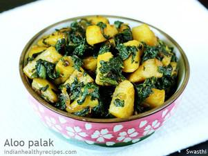

# Aloo Palak

## Ingredients

### Ingredients for aloo palak recipe
- 2 tablespoons oil
- ¾ teaspoon cumin or jeera
- 2 cloves garlic (chopped or paste) or ginger
- 1 pinch asafoetida or hing (optional)
- 2 green chilies (deseeded and chopped)
- 1 medium onion sliced or chopped (optional)
- 2 cups potatoes or aloo cubed about 4 medium potatoes
- 4 cups spinach or palak chopped (more if you like)
- ¼ teaspoon Salt to taste (adjust to taste)
- ¼ teaspoon red chili powder optional
- 1/8 teaspoon turmeric or haldi
- 1 tablespoon lemon juice

### Optional ingredients
- ¼ to ½ teaspoon GARAM MASALA (optional)
- 1 teaspoon toasted sesame seeds (optional)
- ¾ teaspoon kasuri methi or dried fenugreek leaves (optional)

## Instructions

1. Rinse the spinach in lots of water a few times and drain them to a colander.
2. Peel & cube the potatoes to bite sized pieces.
3. optional – Keep them immersed in a bowl of water to avoid discoloration.

### How to make aloo palak
4. Heat 2 tablespoons oil in a pan.
5. When the oil turns hot add ¾ teaspoon cumin and let them splutter.
6. Then add 2 cloves of garlic finely chopped and 1 to 2 chopped green chilies.
7. Fry them for a minute. Sprinkle hing.
8. Next add medium sized chopped or sliced onion and fry until light golden.
9. Drain the water from potatoes completely.
10. Then add them to the pan & fry for 2 to 3 mins.
11. You can just stir fry until the potatoes are fork tender or Pour 3 tablespoons water and mix well.
12. Cover and cook until the potatoes are completely cooked but not mushy.
13. Then sprinkle 1/8 teaspoon turmeric, ¼ teaspoon salt and ¼ teaspoon chili powder (optional).
14. Saute for a minute or two until the raw smell of chili powder goes away.
15. You can also cover and cook for 2 minutes.
16. Next add 4 cups of chopped palak.
17. Saute on a medium high flame for about 3 minutes or until the leaves wilt.
18. You can also sprinkle some garam masala and crushed kasuri methi (optional).
19. When the moisture evaporates turn off the stove.
20. You can sprinkle 1 tsp of sesame seeds towards the end.
21. Serve aloo palak with roti, chapati, paratha or rice.
