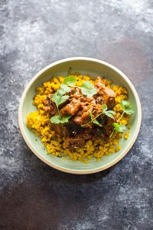

# Aubergine Curry with Turmeric Cauliflower Rice

## Ingredients

- 3 tablespoons olive oil
- 1 large onion, finely chopped
- 2 garlic cloves, crushed
- 2.5cm (1in) piece of ginger, peeled and grated
- 3 aubergines, cubed
- 2 teaspoons nigella seeds or black mustard seeds
- 2 teaspoon garam masala
- 1 x 400g (14oz) tin chopped tomatoes
- 200g (7oz) natural yoghurt, plus extra to serve

### For the cauliflower rice
- 1 tablespoon olive oil
- 1 garlic clove, crushed
- 1 teaspoon ground turmeric
- 800g (1lb 12oz) riced cauliflower (shop-bought or homemade)

## Instructions

1. Heat half the oil in a large sauté pan and gently fry the onion for six minutes until softened. Add the garlic and ginger and fry for one minute, then add the rest of the oil and the aubergines. Increase the heat and brown the aubergines on all sides.
2. Add the nigella (or mustard) seeds, garam masala, tomatoes and plenty of seasoning, reduce the heat and bubble for 15 minutes until the aubergine is lovely and tender and the sauce has thickened.
3. Meanwhile, prepare the cauliflower rice: heat the oil in a saucepan fry the garlic and turmeric for 30 seconds, then add the riced cauliflower and a splash of water. Cover and steam for 5 minutes until hot and tender. Season well.
4. Stir the yoghurt through the curry and allow to simmer gently for 1–2 minutes. Serve with the cauliflower rice and an extra dollop of yoghurt.
5. Click here for more vegetarian recipes.

## Notes

To make your own cauliflower rice, break a head of cauliflower into florets and pulse in a food processor until it has broken down into small granules. Reprocess any larger, whole pieces until they are the same size as the rest of the cauliflower. Can be eaten hot or cold.
