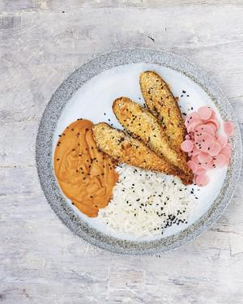

# AUBERGINE KATSU CURRY with pickled radishes

## Ingredients

### For the radishes
- 100g radishes, trimmed and finely sliced
- ½ tsp salt
- 3 tbsp mirin
- 3 tbsp white wine vinegar

### For the curry
- 3 tbsp rapeseed oil
- 1 onion, chopped
- 2 medium carrots (200g), peeled and finely diced
- 1 sweet potato (200g), peeled and finely diced
- 4 cloves of garlic, sliced
- 1.5cm ginger, peeled and grated
- 2 tbsp curry powder
- 10 tbsp plain flour
- 500ml vegan vegetable stock
- 2 tbsp light soy sauce
- 2 tbsp tomato ketchup
- salt
- 2 aubergines (600g), cut lengthways into 0.5cm-thick slices
- 200g panko breadcrumbs

## Instructions

1. Preheat the oven to 180°C fan/200°C/400°F/gas 6. Put the radishes into a heatproof bowl, cover with 100ml of just-boiled water, and add the salt, mirin and vinegar. Stir and leave to cool.
2. To make the sauce, heat the oil in a lidded frying pan, then fry the onion, carrots and sweet potato for 10 minutes. Add the garlic and ginger, fry for 2 minutes more, cover and leave to steam through for 5 minutes. Add the curry powder, mix, then stir in 2 tablespoons of flour until the vegetables are coated. Add the stock little by little, then bring to the boil. Add the soy sauce, ketchup and ½ teaspoon of salt, then take off the heat. Blend smooth, then return the sauce to the pan.
3. Line an oven tray with baking paper. Put the aubergines on a plate. Put 8 tablespoons of flour on a second, lipped plate, then slowly mix the flour with 180ml of water and ½ teaspoon of salt to make a thin paste. Put the panko on a third plate. Cover both sides of each aubergine slice in the flour paste, shaking off any excess, then press into the panko to coat. Lay the coated slices on the prepared tray and drizzle both sides with oil. Bake for 15 minutes on each side, turn the heat up to 220°C fan/240°C/475°F/gas 9 and cook for 10 minutes more, until crisp, then take out of the oven.
4. Just before serving, gently reheat the curry sauce for 5 minutes, adding more water and salt if need be. Put 3 or 4 aubergine slices on each plate, alongside the sauce, then serve with some drained pickled radish, rice, salad leaves and a sprinkling of black sesame seeds if you like.

## Notes

Von Meera Sodha - East
