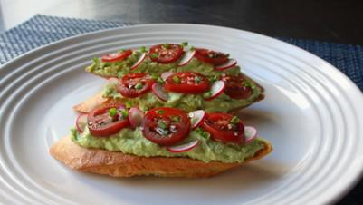

# Avocado Ricotta Crostini

## Ingredients

- 1 baguette, sliced
- 2 drizzles olive oil, or to taste
- 1 large ripe Hass avocado
- 3/4 cup ricotta cheese, or more to taste
- 1/2 lemon, juiced
- 1 tablespoon finely sliced fresh basil
- kosher salt to taste
- 1 pinch cayenne pepper, or to taste
- 1 cup cherry tomatoes, sliced, or to taste
- 5 radishes, sliced, or to taste
- 1 pinch flaky sea salt
- 1 teaspoon snipped fresh chives

## Instructions

1. Preheat the oven to 375 degrees F (190 degrees C).
2. Line a baking sheet with a silicone mat. Add baguette slices in a single layer and drizzle olive oil on top.
3. Bake in the preheated oven until golden brown and crunchy, about 25 minutes. Let crostini cool completely.
4. Halve and pit avocado. Scoop flesh out into a bowl and add ricotta cheese. Mash together using a potato masher until as smooth or chunky as you like. Add lemon juice, basil, salt, and cayenne; mix together, taste, and add more salt if needed. Spread mixture over the cooled crostini.
5. Garnish crostini with tomatoes and radishes. Add a few drops of olive oil; sprinkle sea salt and chives on top.

## Notes

Feel free to incorporate the zest of the lemon as well.

I did roughly equal parts cheese and avocado, but of course you can play around with this ratio, depending on your mood. The same goes for the garnishes, where any number of fresh or pickled seasonal vegetables would work wonderfully, as would a scattering of crispy bacon.
