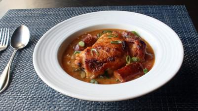

# Baked Chicken and Sausage Gumbo

## Ingredients

- 1 cup all-purpose flour
- 1/4 cup vegetable oil
- 55 g melted butter
- 6 bone-in, skin-on chicken thighs
- 1 pound smoked pork sausage, cut into 2-inch pieces
- kosher salt to taste
- 1 large onion, diced
- 1 cup diced celery
- 1 cup diced green bell pepper

### For the Cooking Liquid
- 6 cups chicken broth
- 2 teaspoons kosher salt
- 1 teaspoon ground black pepper
- 1/2 teaspoon dried thyme
- 1 bay leaf
- 1/4 teaspoon cayenne pepper, or to taste
- 1 cup diced tomatoes
- 1 cup frozen sliced okra, thawed
- 4 green onions, chopped

## Instructions

1. Preheat oven to 400 degrees F (200 degrees C).
2. Stir flour, oil, and butter together to form a paste. Transfer "roux" to the center of a large roasting pan and spread out into a rough rectangle about 1/2-inch thick, leaving enough room around the outside to place the chicken and sausage.
3. Lay chicken thighs, skin-side down, and sausage pieces around the roux. Season chicken generously with salt.
4. Bake in the preheated oven for 40 minutes. Remove from oven and scatter onion, celery, and bell pepper evenly over the chicken, sausage, and roux. Briefly stir the roux in the center, then spread it back out. Continue baking for 20 minutes.
5. Remove pan from oven; remove chicken and sausage to a plate and reserve until needed. Stir vegetables and roux together in the pan, spread back out into an even layer, and bake for another 20 minutes, or until roux is as browned as you like.
6. Mix chicken broth, salt, pepper, thyme, bay leaf, and cayenne in a large bowl or pitcher. Refrigerate cooking liquid until needed.
7. Pour the cold cooking liquid mixture into the gumbo and whisk until well combined. Stir in tomatoes and okra. Add the sausage and chicken back in, skin-side up. Continue baking, stirring gently and occasionally, until liquid is thick and chicken is very tender, 30 to 40 minutes more.
8. Taste and adjust seasonings as desired. Garnish with green onions.

## Notes

Alternative Method:

After the step where the roux and vegetables have been baked and browned, the mixture can be transferred to a soup pot and finished there, by adding the cooking liquid, the rest of the ingredients, and simmering on medium-low until done.

Any smoked pork sausage will do, such as linguica or andouille. My linguica was garlicky, but if yours isn't, minced garlic can be added to the cooking liquid if desired.

Add up to 2 more cups of chicken broth after the final round of baking for a less-thick gumbo.

Once chicken thighs are cooked, the meat can be removed from the bone and added back in for a boneless service.
