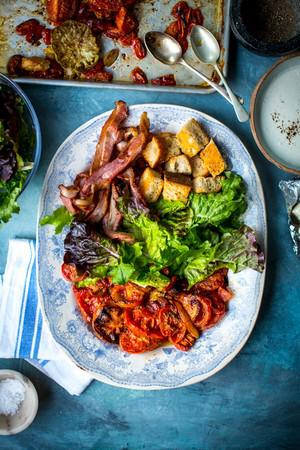

# Blt Salad with Blue Cheese Dressing

## Ingredients

- 8 slices smoked streaky bacon, fried until crispy
- 1 head romaine lettuce, leaves torn and washed
- 250g sour dough bread (half a loaf), cut into large croutons
- Sea salt & ground black pepper

### For the tomatoes
- 350g cherry tomatoes (or a variety)
- 2 tbsp olive oil
- 1 tbsp balsamic vinegar

### For the dressing
- 100ml yoghurt
- 1 heaped tbsp mayonnaise
- 1 small clove garlic, finely minced
- 50g/3 tbsp blue cheese
- Juice of ½ lemon

## Instructions

1. Preheat the oven to 200˚C/400˚F.
2. Add the tomatoes to a large roasting tray and drizzle with oil and vinegar and season generously with salt & pepper.
3. Place in the oven to roast for 35-40 minutes or until reduced and caramelised. While the tomatoes roast, prepare the bacon and romaine lettuce leaves.
4. For the dressing, whisk together all the ingredients in a small mixing bowl and season to taste. Set aside.
5. Toss the cubed sour dough pieces with olive oil and salt & pepper on a large roasting tray. Add to the oven alongside the tomatoes and roast for 10 minutes or until the bread turns crisp and golden.
6. Once cooked remove the tomatoes and bread from the oven and allow to cool. Assemble the salad ingredients, the tomatoes, bacon, croutons and lettuce leaves, on a large platter and drizzle with blue cheese dressing just before serving.
