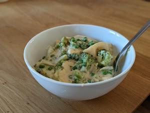

# Brokkoli-Tortellini

## Ingredients

- 500g Tortellini
- 1 Kopf Brokkoli
- Erbsen
- 2 EL Butter
- 1 EL Mehl
- 250 ml Milch
- 200 ml Sahne
- 30g Parmesan gerieben
- 100g Gouda gerieben
- Muskatnuss
- Rauchsalz
- Pfeffer

## Instructions

1. Brokkoli + Strunk klein schneiden. In Butter leicht braun anbraten.
2. Nudelwasser aufsetzen.
3. Wenn Brokkoli langsam weich wird, Mehl hinzufügen. Kurz mit anschwitzen. Dann Milch unterrühren. Wenn glatt gerührt Sahne hinzufügen.
4. Tortellini für 3 Minuten ins Nudelwasser.
5. Sauce mit Pfeffer und Muskatnuss würzen.
6. Wenn Nudeln fertig in Sauce transferieren. Optional Nudelwasser zu Sauce. Käse einrühren. Wenn geschmolzen, abschmecken und fertig.
