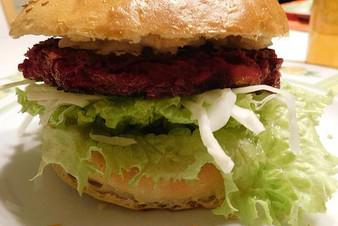

# Burger-Buns Von Custom-Griller

## Ingredients

- 150 ml Milch, warm
- 1 Ei(er)
- 22 ½ g Butter, geschmolzen
- ¾ EL Zucker
- 10 ½ g Frischhefe
- 0.38 TL Salz
- 250 g Mehl
- 1 EL Wasser
- n. B. Sesam

## Instructions

1. Warme Milch, Zucker, Hefe und geschmolzene Butter verrühren und beiseite stellen, bis es schäumt. In einer anderen Schüssel das Mehl mit dem Salz vermischen. Das Hefegemisch und ein Ei hinzugeben und vermischen. Mit der Maschine alles in 5 - 7 Minuten zu einem Teig verkneten. Der Teig sollte nicht klebrig, aber auch nicht zu fest sein. Ggf. mit etwas Milch oder Mehl nachhelfen. Den Teig eine Stunde an einem warmen Ort gehen lassen.
2. Wenn 01sich das Volumen des Teiges etwa verdoppelt hat, die Luft wieder aus dem Teig rauskneten. Den Teig in etwa 8 - 9 gleich große Teile von 100 - 110 g teilen. Daraus die Buns formen und auf das Backblech legen. Mit Frischhaltefolie bedeckt etwa 45 Minuten an einem warmen Ort gehen lassen. Alle 10 Minuten die Frischhaltefolie anheben, damit der Teig nicht daran kleben bleibt.
3. Das zweite Ei mit dem Wasser verquirlen, die Buns damit bestreichen und mit Sesam bestreuen. In etwa 20 Minuten im vorgeheizten Backofen bei 190 °C goldbraun backen.
4. Mit einem Küchentuch bedeckt etwa 15 Minuten abkühlen lassen. Das mit dem Küchentuch ist wichtig, denn nur so bleiben die Buns schön weich.
