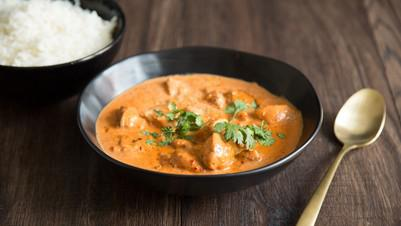

# Butter Chicken

## Ingredients

### For the chicken
- 300 gms Chicken breast boneless
- 1 tbsp Ginger garlic paste
- 1 tbsp Red chilli powder
- Salt to taste
- Oil to pan fry

### For the gravy
- 500 gms roughly slit tomatoes
- 100 gms roughly cut onions
- 1 tbsp garlic paste
- 50 gms cashew
- 1 tsp kasoori methi
- 1/2 tsp garam masala
- 4 tbsp sugar
- 2 tbsp kashmiri chilli powder
- 5 tbsp butter
- 3 tbsp cream
- 2 tbsp malt vinegar / 1.5 tbsp White Vinegar
- Salt to taste

## Instructions

1. Marinate the chicken with ginger paste, garlic paste, red chilli powder and salt and keep it aside for 15 to 20 minutes
2. In a pan heat some oil then fry the marinated chicken pieces in it,once done place it into a bowl.
3. In the same pan add onion, oil, spoonful of butter and once the onions are cooked add tomatoes and cashew nuts Add some water and garlic paste, salt, malt vinegar, sugar, garam masala powder and chilli powder. Evenly mix it and let it simmer for 15-20 minutes
4. Churn the mixture into fine puree.
5. Strain it back into the same pan make sure there is minimal wastage.
6. Add butter, cream, chicken and kasoori meethi and let it simmer for 5-7 minutes.
7. Garnish it with cream and kasoori meethi
