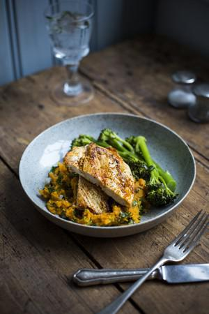

# Cajun Chicken with Sweet Potato Smash

## Ingredients

- 200g tenderstem broccoli
- 2 skinless chicken breasts (about 150g each)
- 1 tsp rapeseed oil
- 1 tbsp smoked paprika
- 1 tsp cayenne pepper
- 1 tsp garlic powder
- 3 thyme sprigs, leaves picked
- Sea salt and freshly ground black pepper

### For the sweet potato smash
- 2-4 sweet potatoes, peeled and diced
- 1 tbsp coconut oil
- Large handful of coriander, roughly chopped

## Instructions

1. Start preparing the sweet potato smash. Place the sweet potato in a metal steamer in a pan of simmering water and steam for 10 -12 minutes or until just tender. You can add the broccoli for the last five minutes of cooking time. Remove the broccoli and keep warm.
2. Transfer the sweet potato to a mixing bowl and use a fork to roughly smash the sweet potato together with the coconut oil and coriander. Season with salt and pepper and keep warm.
3. Butterfly the chicken: place a chicken breast on a chopping board and, with your hand flat on the top of it, use a sharp knife to slice into the thickest part of the breast. Do not slice all the way through. Open out the chicken so it resembles a butterfly and repeat with the other chicken breast.
4. Lay the butterflied chicken on a plate and rub with rapeseed oil. Sprinkle all over with paprika, cayenne pepper, garlic powder, thyme leaves and season with salt and black pepper.
5. Place a large griddle pan over a high heat and cook the chicken for 3-4 minutes on each side, or until cooked all the way through. Serve the chicken with the sweet potato mash and tenderstem broccoli.
