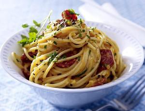

# Carbonara

## Ingredients

- 200g Spaghetti
- 125g Bacon Würfel
- 3 Eier
- 30-50g Parmesan

## Instructions

1. Nudelwasser mit ordentlich Salz zum Kochen bringen. Spaghetti al dente kochen. Wenn die Spaghetti in das Wasser kommen, Bacon in Pfanne anbraten. Wenn Bacon anfängt braun zu werden, Pfanne ausschalten.
2. Währenddessen die Eier in einer Schüssel aufschlagen und den geriebenen Parmesan dazurühren. Pfeffern und vorsichtig salzen.
3. Wenn die Spaghetti al dente sind, Spaghetti in Pfanne transferieren. Etwas Nudelwasser mit in die Pfanne geben. Ei-Parmesan Mischung in die Pfanne geben und unter viel rühren warm werden lassen. Bei Bedarf Herdplatte wieder anmachen. So lange erwärmen und rühren bis eine feste Sauce entsteht die an den Nudeln "klebt".
