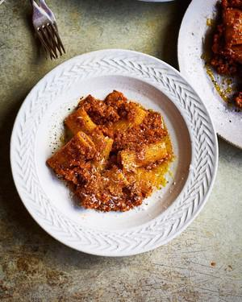

# Cauliflower Bolognese

## Ingredients

- 650g / 1lb 7oz cauliflower, broken into florets
- 250g / 9oz chestnut mushrooms, finely chopped
- 3 tbsp olive oil
- 1 onion, finely chopped
- 3 garlic cloves, crushed
- Good pinch of chilli flakes
- 2 sprigs of rosemary, leaves stripped and finely chopped
- 3 tbsp tomato purée
- 300g / 10oz chickpea pasta
- 40g / 1.5oz Parmesan cheese, finely grated

## Instructions

1. In a food processor, blitz the cauliflower until it is riced and tip into a bowl. Add the mushrooms to the food processor and pulse these too until they are chopped small.
2. Heat the oil in a large sauté pan and fry the onion for 5 minutes over a medium heat until soft, then add the garlic, chilli flakes and rosemary and fry for 30 seconds.
3. Add the cauliflower and mushrooms, season well with salt and pepper and fry over a high heat for 6–7 minutes. Add the tomato purée and cook for a few more minutes.
4. Meanwhile, cook the pasta in a saucepan of boiling salted water for 10 minutes. Drain, reserving 250ml (1 cup) of the water. Add the pasta to the cauli ower pan and toss together with half the Parmesan for 2–3 minutes, loosen with the reserved pasta cooking water as needed.
5. Serve with the rest of the Parmesan scattered over the top.
