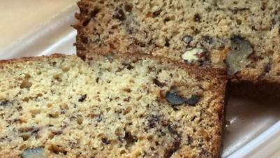

# Chef John's Banana Bread

## Ingredients

- cooking spray
- 250 g all-purpose flour
- 1 teaspoon salt
- 1 teaspoon baking powder
- 1 teaspoon baking soda
- 115 g butter, softened
- 3 ripe bananas, mashed
- 200 g white sugar
- 2 large eggs
- 1/4 teaspoon vanilla extract
- 1 tablespoon milk
- 1 cup chopped walnuts
- 1/3 cup semisweet chocolate chips

## Instructions

1. Preheat the oven to 325 degrees F (165 degrees C). Coat a 9x4-inch loaf pan with cooking spray.
2. Whisk flour, salt, baking powder, and baking soda together in a bowl.
3. Beat butter and sugar with an electric mixer in a large bowl until smooth. Add mashed bananas and beat until combined. Beat eggs into the butter mixture one at a time, fully blending each egg before adding the next. Stir vanilla extract and milk into the mixture.
4. Stir chopped walnuts, chocolate chips, and flour mixture into banana mixture until just incorporated.
5. Pour batter into the prepared loaf pan. Tap pan on the counter to release any air pockets.
6. Bake in preheated oven for about 1 hour 10 minutes, or until an inserted toothpick comes out clean.
7. Let the bread rest in the pan for 15-20 minutes; remove from pan, slice, and serve.
