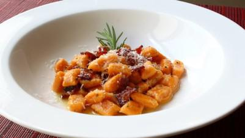

# Chef John's Sweet Potato Gnocchi

## Ingredients

- 1 h 10 m 8 servings 237 cals
- 1 large orange sweet potato
- 1/4 cup whole-milk ricotta cheese (optional)
- 1 large egg, beaten
- 1 1/2 teaspoons kosher salt
- 1 pinch cayenne pepper
- 2 cups all-purpose flour, or more as needed

### Bacon-Butter Sauce (Optional)
- 2 slices bacon, cut into 1/2-inch pieces
- 3 tablespoons unsalted butter
- 1 teaspoon minced fresh rosemary
- salt to taste
- 2 tablespoons freshly grated Parmigiano-Reggiano, divided, or to taste

## Instructions

1. Prick a sweet potato all over with a sharp knife and microwave until very soft, 5 to 7 minutes. Let sit until cool enough to handle.
2. Cut potato in half and scoop flesh into a bowl. Mash or blend until smooth. Add ricotta cheese, egg, kosher salt, and cayenne; mix with a spoon until smooth and combined. Stir in flour until mixture comes together into a sticky ball of dough, adding more flour as needed.
3. Transfer to a floured surface and knead gently, adding flour as needed, until no longer sticky. Divide into 8 portions. Roll into ropes about 1/2-inch thick, using flour as needed. Dust ropes with flour and cut with a bench scraper into 1/2-inch pieces. Transfer pieces onto a sheet pan and let dry on the pan for 15 to 20 minutes, or refrigerate until needed.
4. While gnocchi dry, bring a large pot of salted water to a boil.
5. Cook bacon in a skillet over medium heat until browned and crisp, 7 to 10 minutes. Add butter and cook until lightly toasted, 2 to 3 minutes. Turn off heat and stir in rosemary. Reserve until needed.
6. Stir gnocchi into the pot of boiling water and cook until they float to the top, 3 to 4 minutes. Use a slotted spoon to transfer cooked gnocchi to the sauce.
7. Heat over medium to medium-high heat, coat with sauce, and season with salt. Turn off heat and stir in 1 tablespoon Parmigiano-Reggiano cheese. Transfer to a warm serving bowl and top with additional Parmigiano-Reggiano.

## Notes

This recipe yields 8 appetizer-sized portions of gnocchi.

I like to roast my sweet potato in the microwave since it's fast and easy, but you could do this in the oven at 375 degrees F (190 degrees C). You can mash the sweet potatoes using a food processor instead of a hand tool, if preferred.

These orange sweet potatoes are sometimes sold as yams in the store. Any variety of sweet potato will work, but these orange ones are the most beautiful, and from what I hear, the most nutritious.

You can use 1 teaspoon fine salt for the gnocchi instead of 1 1/2 teaspoons kosher salt, if preferred.

If you want to fry your gnocchi in its sauce a little more aggressively over higher heat, use a nonstick pan for that, because these can stick.

These gnocchi would also work in your favorite pasta sauce, whether that's a simple, tomato-based marinara, a rich and decadent Gorgonzola cream sauce, or anything you might serve with regular potato gnocchi.
