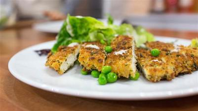

# Chicken Schnitzel with Little Gem and Pea Caesar Salad

## Ingredients

### CAESAR DRESSING
- 1 medium egg
- 2 anchovy fillets (from a jar or tin)
- Few drops of Worcestershire sauce
- 1 teaspoon lemon juice
- 4 ounces rapeseed oil (Can use sunflower oil or safflower)
- Sea salt and freshly ground black pepper

### FOR SCHNITZEL
- 2 large skinless chicken breast fillets (about 5 1/2 ounces each)
- 2 cups rustic breadcrumbs (preferably sourdough)
- 3 tablespoons freshly grated Parmesan
- 1 tablespoon freshly chopped flat-leaf parsley
- 1 egg
- 2 tablespoons milk
- 1/4 cup seasoned flour
- 3 tablespoons grapeseed oil
- 4 Little Gem lettuces, trimmed and quartered
- 1/3 cup peas

## Instructions

1. First, make the Caesar dressing. Put the egg, anchovy fillets, Worcestershire sauce and lemon juice in a mini food processor and process until just combined. With the motor running, gradually add the grapeseed oil and process until thick and creamy. Season with salt and pepper and add a little water if you find the dressing a little thick.
2. Slice each chicken fillet in half and then flatten the pieces slightly by placing between two sheets of plastic wrap and bashing with a rolling pin to make thin escalopes. Place the breadcrumbs in a bowl with the Parmesan and parsley and beat the egg and milk together in a separate bowl. Dust the chicken escalopes in the seasoned flour, then dip in the beaten egg mixture and coat in the breadcrumbs.
3. Place a large, non-stick frying pan over a medium-high heat. When the pan is hot add the grapeseed oil and then add the coated chicken escalopes. Cook for 2-3 minutes on each side, turning once, until the chicken is cooked through and the Parmesan crumbs are golden. Drain on paper towels.
4. Arrange the Little Gem lettuces, cut sides up, on each plate and scatter over the peas. Drizzle the Caesar dressing over the salad, and then add a chicken schnitzel to each plate to serve.
