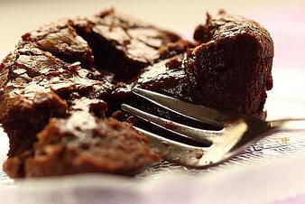

# Chocolate Lava Muffins

## Ingredients

- 60 g Schokolade, zartbitter, am 60%-ige
- 30 g Butter, weich
- 0.25 TL Vanillezucker
- 25 g Zucker
- 10 g Mehl
- 1 Prise(n) Salz
- 1 Ei(er)
- Butter für die Form
- 0.5 EL Kakaopulver, ungesüßt

## Instructions

1. Schokolade und Butter über dem Wasserbad schmelzen. In der Zwischenzeit Vanillezucker, Zucker, Salz und Mehl mischen. Ein Ei nach dem anderen unter die trockenen Zutaten rühren, bis ein glatter Teig entsteht. Die leicht abgekühlte, flüssige Schokolade hinzugeben, unterrühren und mit einem Rührgerät auf der höchsten Stufe ca. 4 Minuten lang dick und cremig schlagen.
2. Die Mulden eines Muffinblechs gut einfetten und mit Kakaopulver ausstreuen, am besten geht das mit einem kleinen Sieb.
3. Die Muffinmulden zu ca. 2/3 mit dem Teig befüllen und bei 190°C Ober-/ Unterhitze 10-11 Minuten backen. Außen soll der Muffin kuchenartig sein, innen jedoch noch flüssig bis sehr weich und saftig. Die Muffins im Muffinblech ein wenig auskühlen lassen, dann vorsichtig lösen. Am besten schmecken sie, solange sie noch warm sind. Kalt schmecken sie immer noch sehr gut, der Kern ist dann jedoch nicht mehr ganz so flüssig.
4. Die Menge ergibt ca. 12 Stück, eignet sich toll als Dessert, z.B. mit Puderzucker oder Kakaopulver bestäubt. Dazu serviere ich gern Schlagsahne oder Vanilleeis und frische Früchte.
