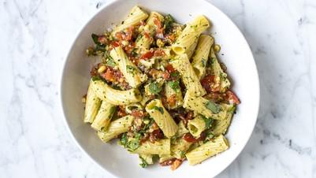

# Chopping Board Pesto

## Ingredients

- 400 g fresh pasta (penne, rigatoni or tortiglioni)
- 50 g pine nuts
- 100 g bunch of basil, leaves picked
- 8–10 medium vine-ripened tomatoes
- 30 g Parmesan, finely grated

### Core ingredients
- 1 garlic clove
- 100–150 ml extra-virgin olive oil
- Sea salt and black pepper

## Instructions

1. Ensure a large saucepan of salted water has come to the boil.
2. Place a small frying pan over a medium heat and add the pine nuts.
3. Add the pasta to the pan and cook the pasta for 3 minutes until just al dente.
4. Meanwhile, crush the garlic and a good pinch of sea salt with the flat of a knife on a chopping board until smooth. tip the toasted pine nuts onto the board with the garlic and roughly chop with the basil and tomatoes until you have a chunky mix.

## Notes

Tip this into a large bowl along with the drained pasta, Parmesan and olive oil. Mix until it’s completely coated in the pesto. Check the seasoning and serve.
