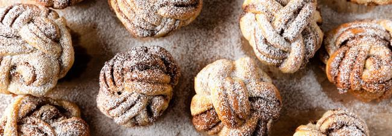

# Cinnamon Buns

## Ingredients

### For The Dough
- 200g Full Fat Milk
- 2 Medium Eggs
- 600g Strong White Bread Flour
- 25g Fresh Yeast
- 50g Caster Sugar
- 10g Salt
- 200g Unsalted Butter

### For The Filling
- 150g Unsalted Butter
- 250g Soft Brown Sugar
- 2 Tsp Cinnamon

### For The Egg Glaze
- 1 Egg
- 2 Tbsp Full Fat Milk

### For The Sugar Glaze
- 100g Caster Sugar
- 100g Water

## Instructions

1. Start by making the dough. Put the milk and eggs into the bowl of a food mixer then add the flour. Break in the yeast to one side of the bowl, then add the salt and sugar and butter to the other side
2. Mix on a slow speed for 4 minutes then increase the speed to medium and mix for a further 10-12 minutes until the dough comes away cleanly from the side of the bowl.
3. Form the dough into a ball and pop into a clean floured bowl. Cover and leave for around 45 minutes or until double in size.
4. Lightly flour a work surface and roll the dough into a rectangle roughly the size of an A3 sheet of paper.
5. For the filling, beat the butter and sugar together until pale and stir in the cinnamon. Spread the filling over the top of the dough.
6. With the long side facing you, fold in half lengthways to enclose the filling and slice it widthways into 12 strips each roughly 3.5cm across. Next, use a sharp knife to cut twice down the length of each strip to make three strands. Plait the three strands together and repeat to make 12 individual plaits.
7. Take each plait and roll it up along its length to create a knot. Grease a 12 cup muffin tray and pop the knots into the tray. Cover and allow to prove for 1 hour.
8. Aim to have your wood fired oven at around 200 °C with little to no flame. Brush the knots with the egg glaze and pop into the oven to bake for between 15-20 minutes until golden.
9. Meanwhile, make the sugar glaze. Put the sugar and water in a pan and bring to the boil, turn down to a simmer until you have a light syrup.
10. Brush the baked knots with the syrup while still hot and leave to cool before devouring.
