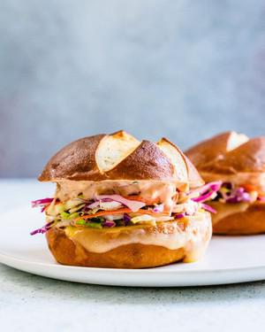

# Coleslaw & Swiss Melt Sandwich

## Ingredients

- 2 cups Best Coleslaw Recipe or Red Cabbage Slaw
- 1/4 cup Easy Russian Dressing
- 4 slices Swiss cheese
- 4 pretzel rolls or 8 slices artisan or rye bread

## Instructions

1. Make the Best Coleslaw Recipe.
2. Make the Easy Russian Dressing.
3. Broiling instructions: Place the bottoms of the pretzel buns on a baking sheet and place a slice of Swiss cheese on top. Place the tops of the buns on the sheet as well. Broil for about 4 to 5 minutes until the cheese is melted and the buns are toasted. OR
4. Stovetop instructions (with bread): Spread butter on one side of each of the bread slices. Heat a griddle pan to medium high heat. Place 4 pieces of bread on the griddle, buttered side down. On each piece, add the cheese slices and coleslaw. Spread Russian dressing on the other side of the other 4 slices of bread and place them on top. When the bottom bread is browned, flip the sandwich and cook until the bread is toasted and the cheese is melted.
