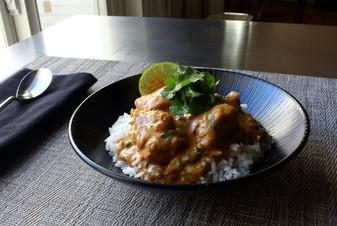

# Creamy Cashew Chicken Curry

## Ingredients

### For the Spice Mix
- 2 teaspoons kosher salt, or more to taste
- 1 ½ teaspoons ground cumin
- 1 teaspoon ground coriander
- 2 teaspoons paprika
- ½ teaspoon cayenne pepper
- ½ teaspoon ground turmeric
- 2 teaspoons garam masala
- 2 pounds boneless, skinless chicken thighs
- 1 tablespoon vegetable oil
- 2 tablespoons butter, divided
- 1 yellow onion, chopped
- 2 tablespoons tomato paste
- 4 garlic cloves, minced
- 1 tablespoon minced fresh ginger root
- 1 cup chicken broth
- 2 cups cold water
- ¾ cup whole roasted cashews
- ⅓ cup sliced green onions
- 1 lime, juiced

## Instructions

1. Mix salt, cumin, coriander, paprika, cayenne, turmeric, and garam masala together in a small bowl.
2. Cut a chicken thigh in half lengthwise along the crease. Halve the thicker portion to end up with three 2-inch pieces. Repeat with remaining chicken thighs.
3. Transfer chicken to a bowl. Add oil and about 1/2 of the spice blend; mix thoroughly. Cover with plastic wrap and marinate in the fridge for 4 to 12 hours.
4. Heat 1 tablespoon butter in a large pan over high heat until melted and golden brown. Add the chicken in a single layer. Cook until browned, 4 to 5 minutes per side. Return chicken and accumulated juices to the bowl.
5. Heat remaining butter in the same pan over medium-high heat. Add onion, remaining spice blend, tomato paste, garlic, and ginger. Cook and stir until fragrant, 2 to 3 minutes. Pour in chicken broth and bring to a simmer. Add the chicken and any accumulated juices.
6. Combine water and cashews in a blender; blend on high speed until very smooth. Stir cashew cream into the pan. Reduce heat to medium and simmer until flavors blend, 15 to 20 minutes. Stir in green onions and taste for seasoning. Squeeze in lime juice.

## Notes

Chef's Notes: Feel free to substitute garam masala with any other prepared curry spice blends.

After adding the cashew cream, you can simmer this for as little as 5 to 10 minutes, or just until the chicken is cooked. Or you can reduce the heat and simmer for up to 45 minutes, depending on how thick you want your sauce.

Try this with my recipe for garlic naan.
