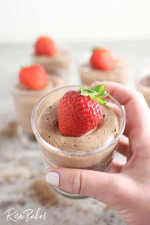

# Creamy No-Bake Chocolate Cheesecake Cups

## Ingredients

- 336 grams chocolate graham cracker crumbs (or crushed OREO cookies)
- 4 tablespoon salted butter, melted
- 948 ml heavy cream or whipping cream
- 86 grams unsweetened cocoa powder
- 240 grams powdered sugar, divided
- 454 grams cream cheese, softened to room temperature
- 2 tsp vanilla

## Instructions

1. In a small bowl, stir together the melted butter and graham cracker crumbs until it’s evenly distributed. Put approximately 2-3 tablespoons of the mixture into the bottom of each glass or serving dish.
2. Add the heavy cream, unsweetened cocoa powder, and ¾ cup powdered sugar into a mixing bowl. Using an electric mixer, beat until stiff peaks form. I prefer to do this in my Bosch mixer with whisk attachments, but any stand mixer or hand mixer will work.
3. In a separate bowl, beat the cream cheese and remaining powdered sugar until soft and completely smooth. Add the vanilla and beat again to combine. Note: if you're using a stand mixer, you can transfer the chocolate mixture to a different bowl and use the same bowl to beat the cream cheese, without cleaning in-between.
4. Fold the cream cheese mixture into the chocolate whipped cream mixture and mix until completely combined.
5. Spoon the mixture into a piping bag (if you like) and pipe it into the cups. Or divide it evenly among your cups and spoon it in.
6. Top with fresh fruit or more cookie crumbs, then cover and chill for at least an hour before serving.
