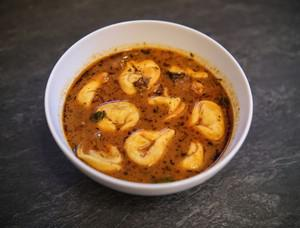

# Creamy Tomato & Chorizo Ravioli Soup

## Ingredients

- 1 tbsp olive oil
- 1 onion, finely chopped
- 150g cooking chorizo, finely diced
- 2-3 thyme sprigs, leaves picked (or use sage or rosemary)
- 700ml chicken stock made from 1 stock cube
- 400ml tomato passata
- 125ml double cream
- 250g packet of ravioli or tortellini
- Handful of fresh basil leaves, to serve
- Sea salt and black pepper

## Instructions

1. Heat the oil in a saucepan and gently fry the onion for 10 minuta over a low heat until softened.
2. Add the chorizo and thyme, increase the heat and fry until the chorizo releases its fragrant oil. Add the stock and tomato passata and cook gently for 15 minutes; season to taste and add the cream.
3. Add the ravioli and cook for 5-6 minutes until cooked through. Serve with a scattering of fresh basil leaves.
