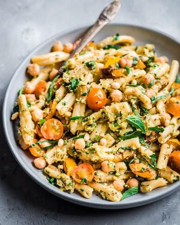

# Creamy Vegan Zucchini Pesto Pasta

## Ingredients

- 1 ½ pounds (900g) zucchini or summer squash (about 4 small-medium)
- 2 1/2 - 3 tablespoons extra virgin olive oil, plus more for finishing
- Kosher salt to taste
- 7 garlic cloves, divided
- 1/4 tsp red pepper flakes, optional
- 12 ounces (375g) pasta of choice
- 1/3 cup (45g) toasted pine nuts or pistachios, plus more for finishing
- 1/2 of a medium or large lemon, zested
- 1 cup fresh basil leaves, divided
- 1/2 cup (80-100g) cherry tomatoes or grape tomatoes, sliced in half or quarters
- 1 can (15-ounce/440g) chickpeas, drained and rinsed

## Instructions

1. Prep the vegetables. Cut each zucchini lengthwise into quarters, then crosswise into chunks (not too thinly; see the photos in the blog post for reference). Slice 6 of the 7 garlic cloves thinly (but not paper thin). Leave the remaining garlic clove whole.
2. Caramelize the zucchini. Heat the olive oil in a large cast iron skillet over medium-high heat. Once the pan is hot, add the zucchini or summer squash and season with kosher salt to taste (I used a heaping 1/2 teaspoon kosher salt). Cook the zucchini, tossing occasionally, until browned in spots, 4-6 minutes. NOTE: for pan alternatives, see the “Tips” section in the blog post.
3. Add the 6 thinly sliced garlic cloves to the zucchini. Cook for another 2-3 minutes until the zucchini just starts to break down, stirring frequently to prevent the garlic from burning. Reduce heat to low and continue cooking until zucchini is soft and jammy, 15-20 minutes, stirring just occasionally. Stir in red pepper flakes at the end, if using.
4. Meanwhile, cook the pasta in salted boiling water according to the package instructions until al dente. Before draining, reserve a few ladles of pasta water.
5. Meanwhile, make the basil-garlic topping. Finely mince the 1 remaining garlic clove. Chiffonade 1/2 cup of the basil and toss with the minced garlic to combine. Set aside.
6. Make the Zucchini Pesto. Meanwhile, add the pine nuts or pistachios to a food processor and blitz until you have a very fine crumb. Transfer about 2/3 of the caramelized zucchini to the food processor (reserve the remaining zucchini for finishing the pasta). Add the lemon zest and the remaining 1/2 cup of the basil and blend until the pesto is pureed but still a little chunky. Taste for seasonings, adding a pinch of salt as needed.
7. Assemble the Pasta. Transfer the hot cooked pasta to a serving bowl. Top with the zucchini pesto, and toss to combine, adding a few spoons of pasta water as needed to emulsify the mixture until the pesto coats the pasta. Add the reserved caramelized zucchini, sliced cherry tomatoes, and chickpeas and toss again. Sprinkle with the basil-garlic topping and toss again. If desired, drizzle with a final splash of extra virgin olive oil. Taste for seasonings, adding additional salt as needed. Store leftovers in an airtight container for 2-3 days.
