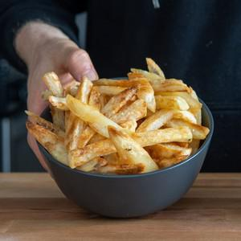

# Crispy Oven Fries

## Ingredients

- russet potatoes 3-5
- salt
- vinegar SOUR 15g
- a splash peanut oil

## Instructions

### Prep
1. Set a pot of water on high heat to boil . Preheat the oven to 450°F/232°C (use the convection setting if you have it). Meanwhile, peel the potatoes, slice them into roughly 1/2 inch sheets, then into roughly 1/2 inch thick fries (or to your desired fry size).

### Parboil the fries
2. Once the water has boiled, add the vinegar and a large pinch of salt, stirring to dissolve the salt. Add the potatoes to the water and boil for 8 minutes. Note: The vinegar will slow down the breakdown of the potato pectin starch so the fries do not fall apart as easily. Boiling the fries will gelate their exterior, which will give you much crispier results in the next steps. When the time is up, pour the fries into a colander and let the excess steam evaporate for a couple of minutes.

### Coat the fries with oil
3. Add the fries to a large baking sheet and pour over the peanut oil. Gently mix the fries around so the oil completely coats the outside of each fry. There should be a thin layer of excess oil on the pan. Make sure the fries aren't overly crowded. They need space to properly dehydrate in the oven. Use 2 baking sheets if needed.

### Roast
4. Add the pan to the preheated oven and roast for 15 minutes. Pull the baking sheet out and flip each fry over with a spatula. At this point, you should be able to see some blistering on the outside but the fries won't be overly crisp. If they look a little dry, drizzle over more peanut oil. Add them back to the oven and roast for another 15-20 minutes. At this point, they should be browned and crispy, though it could take longer depending on the size of the fry, how crowded the pan is, or the amount of oil used. If they aren't crispy, let them go longer!

### Finish & serve
5. Set a paper towel in a bowl. Add the fries and immediately season with salt while they are warm with oil on their surface. Toss the fries with the paper towel so it absorbs the excess oil. Taste and adjust with more salt, if needed.
