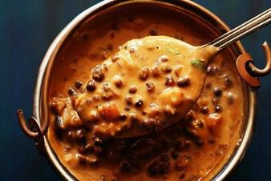

# Dal Makhani

## Ingredients

- ¾ cup whole urad dal , 140 grams (whole black gram)
- ¼ cup rajma , 40 grams (kidney beans)
- 3 cups water for pressure cooking , 750 ml water
- ½ cup finely chopped onions , 50 grams onion or 1 medium sized onion
- 1 teaspoon chopped green chilies or serrano peppers or 1 to 2 green chillies
- 2 teaspoons Ginger-Garlic Paste or 6 to 7 small to medium-sized garlic + 1 inch ginger – crushed to a paste in mortar-pestle
- 2 large tomatoes , 200 grams tomatoes – pureed or 1 cup tomato puree
- ½ teaspoon cumin seeds
- 2 to 3 cloves
- 2 to 3 green cardamoms
- 1 black cardamom
- 1 inch cinnamon
- 1 small to medium tej patta (Indian bay leaf)
- ½ teaspoon red chili powder or cayenne pepper or smoked paprika
- 2 to 3 pinches grated nutmeg or ground nutmeg powder
- 1 cup water or add as required
- ¼ to ⅓ cup low fat cream or half and half or 2 tablespoons heavy cream or
- ¼ teaspoon crushed kasuri methi (dry fenugreek leaves) – optional
- 3 tablespoon butter – salted or unsalted
- salt as required

### For Dhungar Method (Optional)
- 1 small piece of charcoal
- ½ to ⅔ teaspoon oil – any neutral tasting oil

### For Garnish
- 1 to 2 tablespoons chopped coriander leaves (cilantro)
- ½ tablespoon low fat cream or half and half for garnish – optional
- 1 inch ginger julienne – optional

## Instructions

1. Soak both the whole urad dal and rajma overnight in enough water for 8 to 9 hours or overnight. Later drain them well.
2. Rinse both the lentils a couple of times in water.
3. Drain again and then add them in a 3 litre pressure cooker. Add water and stir well.
4. Pressure cook for 18 to 20 whistles on a high flame, till both the urad dal and rajma have cooked thoroughly and softened. If they are not cooked, then add about ½ cup water again and pressure cook for 4 to 5 whistles more.
5. The urad dal should melt in the mouth and should not give any bite or resistance when eaten. You can also just mash the urad dal with a spoon or with your fingers to check the doneness. The same rule applies for rajma too. Keep the cooked beans aside.
6. In a blender or mixer jar, take chopped tomatoes and blend to a smooth puree. Set aside.
7. You can also add ready 1 cup tomato puree instead of blending the tomatoes. No need to blanch the tomatoes while pureeing.

### Making Dal Makhani
8. In a pan, now heat butter. You can use salted butter or unsalted butter.
9. Add the whole spices – cumin seeds, cloves, green cardamoms, black cardamom, 1 inch cinnamon, 1 small to medium tej patta.
10. Fry for some seconds till the spices sputter and become aromatic.
11. Add finely chopped onions.
12. Stir and sauté the onions on a low or medium-low heat often till they become light golden.
13. Add the ginger garlic paste. Stir again and sauté for some seconds till the raw aroma of ginger-garlic goes away.
14. Add the chopped green chilies and sauté for a minute.
15. Add the prepared tomato puree and mix well.
16. Add red chili powder and 2 to 3 pinches of grated nutmeg or nutmeg powder.
17. Stir very well and sauté this mixture on a low to medium flame, till you see fat releasing from the sides.
18. Then add the cooked urad dal and rajma beans along with the stock. Also add 1 cup water or as required.

### Slow Cooking
19. Stir very well and simmer the dal makhani uncovered on a low flame.
20. Keep on stirring often, so that the lentils don’t stuck to the bottom of the pan.
21. Once it has begun to thicken, add salt as required.
22. Stir very well and continue to simmer on a low flame. Keep on stirring when the lentils are simmered on low heat.
23. When simmering you can add more water if the gravy looks thick or dry. The longer you keep dal makhani to simmer, the better it tastes.
24. I kept it for about an overall 25 minutes on a low flame. Do keep on stirring at intervals.
25. When the gravy has thickened enough, then add cream. Dal makhani is not too thick or too thin. It has a medium consistency.
26. Mix the cream very well. Then switch off the heat.
27. Add crushed kasuri methi (dried fenugreek leaves). Mix again.
28. Cover and set dal makhani aside, if you are proceeding to the dhungar method. Or else you can serve dal makhni straight away.

### Dhungar Method
29. Heat a small piece of charcoal on flame till it becomes red hot. With the help of tongs, keep on turning the charcoal piece so that it evenly burns.
30. Keep the red hot charcoal in a small bowl.
31. Pour ½ teaspoon oil on the hot charcoal.
32. Immediately keep this bowl on top of the dal makhani.
33. Cover for a minute and allow the charcoal to infuse its smoke in the dal makhni. Remove the bowl. Stir again.
34. Serve punjabi dal makhani garnished with chopped coriander leaves (cilantro) and a few teaspoons of cream with naan, roti, paratha or steamed rice.

## Notes

Cooking in pot or pan: Add the the soaked black gram, kidney beans and 3 to 4 cups water in a large pot. Cover and cook on medium heat till the lentils and beans soften. Add water as needed. If cooking the beans in a pot, it may take from 45 minutes to 1 hour.

Soaking: It is always better to soak beans overnight or for 8 to 9 hours. Soaking reduces the phytic acid in them which causes indigestion and flatulence. Soaking also helps the beans to cook faster.

Rinsing: Before cooking, rinse the soaked beans in water a couple of times. Then drain all the water and cook the beans with fresh water.

Cooking: When you soaking beans and lentils the cooking time considerably reduces by 25%. You can then cook the soaked beans in a pan or in a pressure cooker or instant pot.
