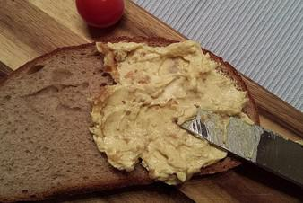

# Datteln-Frischkäse-Aufstrich Mit Curry

## Ingredients

- 150 g Dattel(n), entsteinte
- 300 g Frischkäse
- 200 g Schmand
- Knoblauchzehe(n)
- TL, gestr. Currypulver
- etwas Cayennepfeffer, ca. 1 - 3 Prisen
- n. B. Salz

## Instructions

1. Zuerst die Datteln sehr klein würfeln (geht auch im Thermomix 6 sec/Stufe 9).
2. Knoblauchzehe schälen und pressen. Frischkäse, Schmand, Datteln, Knoblauch und Gewürze gut verrühren (evtl. auch im Thermomix).
3. Leckerer Aufstrich für Partys, schmeckt besonders gut mit selbst gebackenem Vollkornbrot.
