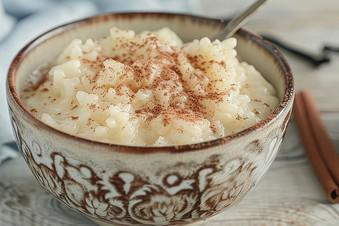

# Der Perfekte Milchreis

## Ingredients

- ¾ Liter Vollmilch, zimmerwarm
- 188 g Milchreis
- 3 EL Zucker
- ¾ EL Butter
- ¾ Vanilleschote(n) oder 1 Pck. Vanillezucker
- n. B. Zimtzucker oder Apfelmus, Rote Grütze bzw. frische Früchte

## Instructions

1. In einem großen(!) Topf die Butter schmelzen, anschließend den Rundkornreis kurz in der Butter anschwitzen. Nun die zimmerwarme Vollmilch sowie 4 EL Zucker hinzugeben. Wenn vorhanden, das Mark einer Vanilleschote sowie die aufgeschlitzte Schote ebenfalls in den Topf geben; andernfalls Vanillezucker hinzufügen. Alles unter vorsichtigem Rühren mit dem Holzkochlöffel einmal aufkochen lassen und dabei aufpassen, dass sich nichts am Topfboden ansetzt.
2. Nun die Temperatur der Herdplatte zurückschalten - die Milch sollte noch leicht weiterköcheln. Den Milchreis im geschlossenen Topf circa 30 Minuten ziehen lassen. Nach ca.15 Minuten evtl. auch früher umrühren.
3. Nach 30 Minuten ist der Reis servierfertig, er kann warm und kalt gegessen werden.
4. Nach Geschmack Zimt und Zucker mischen und über den Milchreis geben oder Apfelmus, Rote Grütze, frisches Obst, etc. dazu reichen.
