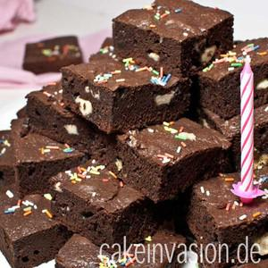

# Die Besten Brownies Überhaupt

## Ingredients

### Teig
- 425 g Schokolade geschmolzen, am besten eure Lieblings-Zartbitterschokolade
- 300 ml Öl, geschmacksneutral
- 6 EL Kakaopulver
- 350 g Zucker
- 3 Pck. Vanillinzucker
- ½ TL Salz
- 3 EL Milch
- 9 Eier
- 300 g Mehl

### Außerdem
- 350 g weiße Schokolade (ihr könnt die weiße Schokolade auch durch Nüsse, Smarties oder zerkleinerte Oreos ersetzen)

## Instructions

1. 25 Minuten bei 175 Ober-Unterhitze backen
