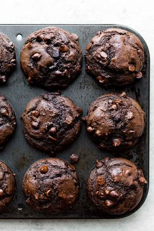

# Double Chocolate Muffins

## Ingredients

- 2 cups ( 250g) all-purpose flour ( spoon & leveled)
- 1 cup ( 200g) granulated sugar
- 1/2 cup ( 41g) unsweetened natural cocoa powder
- 1 teaspoon baking soda
- 1/2 teaspoon salt
- 1 and 3/4 cups ( 315g) semi-sweet chocolate chips
- 2 large eggs, at room temperature
- 3/4 cup ( 185g) full fat sour cream or plain yogurt, at room temperature
- 1/2 cup (120ml) vegetable oil*
- 1/2 cup (120ml) whole milk, at room temperature
- 1 and 1/2 teaspoons pure vanilla extract

## Instructions

1. Preheat oven to 425°F (218°C). Spray a 12-count muffin pan with nonstick spray or use cupcake liners. This recipe yields about 14 muffins, so prepare a second muffin pan in the same manner or bake in batches and reserve leftover batter at room temperature for when the first batch is done.
2. Whisk the flour, sugar, cocoa powder, baking soda, salt, and chocolate chips together in a large bowl. Set aside.
3. Whisk the eggs, sour cream, oil, milk, and vanilla extract together until combined. Pour wet ingredients into dry ingredients and fold together with a rubber spatula or wooden spoon until completely combined. (Batter is quite thick, so I recommend a spatula or spoon over a whisk.) Avoid overmixing. The batter will be thick and sticky.
4. Spoon the batter into liners, filling them all the way to the top. Bake for 5 minutes at 425°F then, keeping the muffins in the oven, reduce the oven temperature to 350°F (177°C). Bake for an additional 15-16 minutes or until a toothpick inserted in the center comes out clean. The total time these muffins take in the oven is about 20-21 minutes, give or take. (For mini muffins, bake 13-14 total minutes at 350°F (177°C) the whole time.)
5. Cool muffins for 10 minutes in the pan, then transfer to a wire rack until ready to eat.
6. Cover leftover muffins and store at room temperature for 5 days or in the refrigerator for 1 week.

## Notes

Freezing Instructions: For longer storage, freeze the muffins for up to 3 months. Thaw overnight in the refrigerator, then heat up in the microwave if desired.

Jumbo Muffins: If you’d like to make about 6 jumbo muffins instead of standard size, follow the recipe through step 3 using a greased jumbo 6-count muffin pan. Spoon batter into the liners, filling all the way to the top. Bake for 5 minutes at 425°F then, keeping the muffins in the oven, reduce the oven temperature to 350°F (177°C). Bake for an additional 25-28 minutes or until a toothpick inserted in the center comes out clean.

Sour Cream: Use full fat sour cream. In a pinch, you can replace it with plain yogurt. (Full fat Greek style or regular yogurt would be best.)

Oil: For best taste and texture, use vegetable oil. In a pinch, you can replace with canola oil or olive oil. The muffins can taste greasy with melted coconut oil, but if you try it, it’s imperative the other ingredients are room temperature so the coconut oil doesn’t solidify as you mix the batter together.

Milk: Whole milk is best. 2%, 1%, or nondairy milk work in a pinch. Do not use nonfat milk. Don’t use buttermilk. (You could use buttermilk if replacing both the sour cream AND milk, but the muffins taste a little spongy that way. Best to use sour cream and whole milk.)

Recipe excerpted from Sally’s Baking Addiction. This version includes more chocolate chips and the addition of vanilla extract for a little extra flavor. The cookbook version also uses plain yogurt, but you can use sour cream as noted here.
