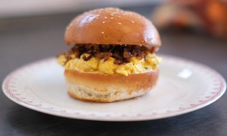

# Eggslut Fairfax

## Ingredients

- 4 eggs
- Butter
- Chives
- Sriracha Mayo
- 2 Slices Cheddar
- Caramelised Onions
- Burger buns

## Instructions

1. Start with a cold pan, crack your eggs straight in and throw in a knob of butter. Stir the eggs and butter together before turning on the heat.
2. When the yolks and the whites of the eggs have created a uniform colour, it’s time to put your pan on the heat.
3. Using a spatula to turn the eggs will create a deliciously velvety texture. When mixing your eggs, scrape the bottom of the pan to fold your eggs over almost as though you’re creating layers.
4. When the eggs are no longer loose, and they stay together, they’re ready. Add a sprinkle of chives on top of your eggs and take them out of the pan so they won’t continue to cook.
5. Place your perfectly cooked eggs between your warmed brioche bun.
6. Add sriracha mayonnaise to give the dish a slight kick.
7. Add a slice of melted cheddar cheese on top. We use a mild variety so that the taste of the eggs isn’t overpowered.
8. Lastly, place caramelised onion on top of the creamy cheddar cheese.
