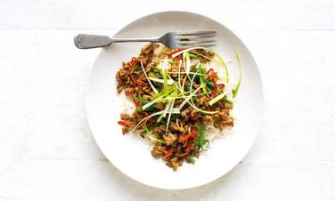

# Five Spice Chicken

## Ingredients

- 4 tbsp soy sauce
- 4 tbsp honey
- 2 tbsp rice-wine vinegar
- 1 tbsp sesame oil
- 2 tsp cornflour
- 2 x 150g chicken breasts, cut into small pieces
- 2 tsp Chinese five-spice
- 2 tbsp sunflower oil
- 2 garlic cloves, peeled and thinly sliced
- 2cm piece fresh ginger, peeled and cut into matchsticks
- 1 red and 1 yellow pepper, deseeded and cut into strips
- ½ small head broccoli, broken into little florets
- 200g sugarsnap peas
- 3 baby pak choi, quartered
- 1 bunch spring onions, thinly sliced on the diagonal, to serve

## Instructions

1. Blend the soy sauce, honey, vinegar, sesame oil and cornflour until smooth. In a separate bowl, toss the chicken pieces in the five-spice.
2. Heat the oil in a wok until smoking, add the chicken, garlic, ginger and peppers, and fry over a high heat for five to six minutes, until the chicken has started to colour.
3. Pour over the soy sauce mixture, then add the broccoli and a splash of water. Cover with a lid, cook for one to two minutes, then stir in the sugarsnaps and pak choi. Cook for a further five to six minutes, until the vegetables are tender and any liquid has reduced. Scatter with the sliced spring onions and serve.

## Notes

Five Spice Chicken
