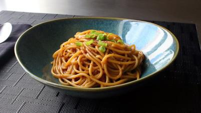

# Garlic Noodles

## Ingredients

- 35 m 2 servings 600 cals

### For the Secret Sauce
- 2 tablespoons soy sauce
- 1 tablespoon oyster sauce
- 2 teaspoons Worcestershire sauce
- 2 teaspoons fish sauce
- 1/4 teaspoon sesame oil
- 1 pinch cayenne pepper

### For the Noodles
- 8 cloves garlic, minced
- 4 tablespoons unsalted butter
- 1/4 cup finely grated Parmigiano-Reggiano cheese
- 1 tablespoon chopped green onion, or to taste
- 6 ounces spaghetti
- 1 pinch red pepper flakes

## Instructions

1. Stir soy sauce, oyster sauce, Worcestershire sauce, fish sauce, sesame oil, and cayenne pepper together in a small bowl for the secret sauce.
2. Place secret sauce near the stove. Place garlic, butter, Parmesan cheese, and green onion in individual bowls within easy reach.
3. Melt butter in a skillet over medium heat. Add garlic; cook and stir just until fragrant, about 1 minute. Quickly stir in the secret sauce and turn off the heat.
4. Bring a large pot of lightly salted water to a boil. Cook spaghetti in the boiling water, stirring occasionally, until tender yet slightly firm to the bite, about 12 minutes.
5. Transfer spaghetti into the sauce using tongs, bringing some of the cooking water with it. Toss until well coated and stir in Parmesan cheese. Splash in more pasta water if noodles are too dry.
6. Plate noodles. Garnish with red pepper flakes and green onions.

## Notes

Apparently, one of their "secret” ingredients is Maggi® Seasoning Sauce, which I decided not to use, since I'm not sure how easy it is for the average person to find. Besides, I think my assortment of savory, umami-rich substitutes did the job quite nicely, and everything in the ingredient list can be found at any large grocery store.

Virtually any noodle will shine in this, but I quite like good old spaghetti. Good options include Chinese egg noodles and ramen.
