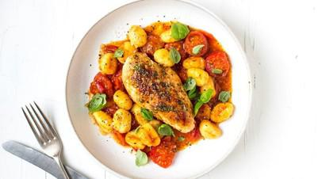

# Garlic & Rosemary Chicken with Gnocchi

## Ingredients

- 2 garlic cloves, crushed
- Pinch of sea salt
- 2 rosemary sprigs,
- leaves stripped
- Pared zest of ó lemon
- 2 chicken breast fillets
- 2 tbsp olive oil
- 300g cherry tomatoes, halved
- Good glug of extra-virgin
- olive oil
- 30g unsalted butter
- 300g fresh gnocchi
- Large handful of basil leaves,
- Grated pecorino, to serve

## Instructions

1. Mash 1 of the garlic cloves on a chopping board with the sea salt until a rough paste forms. Add the rosemary leaves and lemon zest and finely chop. Smear the garlic and herb paste over the chicken breasts to coat both sides.
2. Heat the oil in a non-stick frying pan, add the chicken breasts and brown over a high heat for 2 minutes on each side until golden.
3. Push the chicken breasts to one side of the pan and add the remaining garlic and tomatoes to the pan with the extra-virgin olive oil and butter. Cook, stirring, until the tomatoes start to soften, then reduce the heat and cook for 10 minutes until the chicken is cooked through and the tomatoes have reduced down slightly.
4. While the chicken cooks bring a large saucepan of salted water to the boil and add the gnocchi. Cook for just a minute or 2 until they float to the surface, then remove them with a slotted spoon and add straight to the chicken pan. Toss until all the flavours marry together.
5. Serve the chicken and gnocchi in wide bowls garnished with basil leaves and pecorino.
