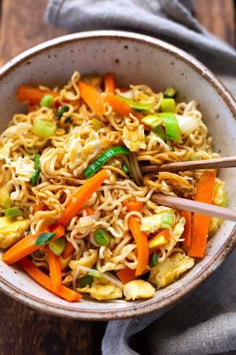

# Gebratene Nudeln Mit Gemüse Und Ei

## Ingredients

- 250 g Mie-Nudeln
- 2 große Karotten
- 1 Stange Lauch
- Handvoll Sprossen z.B. Sojasprossen
- Frühlingszwiebeln
- 2-3 EL Sesamöl
- 3 Eier verquirlt
- 1/2 TL brauner Zucker
- 3 EL Sojasauce
- Salz

## Instructions

1. Die Nudeln nach Packungsanweisung zubereiten.
2. Karotten und Lauch putzen und in feine Streifen schneiden. Sprossen waschen. Frühlingszwiebeln putzen und in Röllchen schneiden.
3. 1 EL Öl in einer großen Pfanne heiß werden lassen. Die verquirlten Eier darin kurz braten, gelegentlich rühren. Karotten, Lauch und Frühlingszwiebeln hinzufügen und 3 – 5 Minuten mitraten.
4. Abgeschüttete Nudeln und Sprossen hinzufügen und weitere 5 Minuten braten. Mit Zucker, Sojasauce, restlichen 1 – 2 EL Sesamöl und Salz abschmecken. Heiß genießen.
