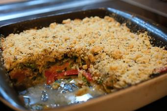

# Gemüse-Crumble

## Ingredients

- 2 Möhren
- 200 g Erbsen (TK)
- 1 rote Zwiebel
- 1 Knoblauchzehe
- 2 Stangen Lauch
- 250 g Champignons
- 1 rote Paprika
- 2 EL Olivenöl
- Salz
- Pfeffer
- 100 g Parmesan
- 50 g Haselnüsse
- 12 Bund Petersilie
- 4 Bund Schnittlauch
- 150 g Mehl
- 100 g Butter
- 3 EL Creme fraiche
- Soja sauce

## Instructions

1. Backofen auf 200 °C Ober-/Unterhitze vorheizen. Möhren schälen, in Scheiben schneiden und 3 Minuten in kochendem Wasser garen. Die Erbsen für 1 Minute zugeben, beides abgießen und kalt abschrecken. Zwiebel und Knoblauch schälen und fein hacken. Lauch gut waschen und in Ringe schneiden, Pilze putzen und vierteln. Paprika waschen, Kerne entfernen und Fruchtfleisch in Streifen schneiden.
2. Öl in einer großen Pfanne erhitzen, Zwiebeln und Knoblauch anschwitzen. Paprika zufügen, danach Lauch und Champignons zugeben und kurz mitgaren. Möhren und Erbsen unterrühren und alles mit Salz und Pfeffer würzen. Gemüse in einer Auflaufform verteilen.
3. Für die Streusel Parmesan fein reiben, Haselnüsse hacken. Kräuter waschen, fein hacken und alles mit Mehl, etwas Salz und Pfeffer mischen. Butter in Stücken zufügen und die Mischung mit den Fingern rasch zu Streuseln verarbeiten.
4. Die Streusel auf dem Gemüse verteilen und den Crumble im vorgeheizten Backofen ca. 15 Minuten goldbraun backen.
