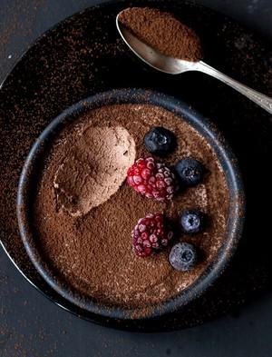

# Geniale 2-Zutaten Mousse Au Chocolat (Ohne Ei)

## Ingredients

- 60 g dunkle Schokolade, fein gehackt oder Schokodrops (ca. 50-55 % Kakaoanteil)
- 120 g kaltes Schlagobers (Schlagsahne), ca. 36 % Fettanteil
- Zum Bestreuen: ungesüßtes Kakaopulver, geraspelte Schokolade oder Früchte (optional)

## Instructions

1. In einem kleinen Topf 30 g (ca. 3 EL) Schlagobers vorsichtig gemeinsam mit der Schokolade erhitzen. Wenn das Obers sehr heiß ist und fast zu köcheln beginnt, den Topf vom Herd nehmen. Die Schokolade schmilzt relativ schnell, wenn sie klein genug gehackt ist. Falls sie noch nicht ganz aufgelöst ist, die Masse noch einmal ganz kurz bei geringer Hitze erhitzen, dabei kontinuierlich Rühren.
2. Wenn die Schokolade klumpenfrei geschmolzen ist, diese mit einem Gummispatel in eine mittelgroße Schüssel leeren/spachteln (in dieser wird dann später alles vermengt) und auf Zimmertemperatur abühlen lassen.
3. Wenn die Schokolade abgekühlt ist (sie soll immer noch sehr weich sein), das restliche Obers (90 g) aufschlagen.
4. Die Hälfte des geschlagenen Obers mit einem Schneebesen oder einer Gummispachtel unter die Schokolade rühren. Sobald beides gut vermengt ist, das restliche geschlagene Obers vorsichtig mit einem Gummispatel unterheben. Das Volumen soll dabei erhalten bleiben.
5. In kleinere Gefäße umfüllen und mindestens 1,5 bis 2 Stunden kühl stellen.
