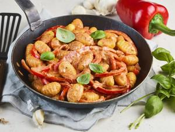

# Gnocchi-Paprika-Pfanne

## Ingredients

- 2EL Pflanzenöl
- 500g Gnocchi (aus dem Kühlregal)
- 2 rote Paprikaschoten (je ca. 200 g)
- 1 rote Zwiebel (je ca. 50 g)
- 1 Knoblauchzehe
- Salz
- Pfeffer
- 2EL Tomatenmark
- 2TL Paprikapulver (edelsüß)
- 100ml Gemüsebrühe
- 150ml Kochsahne (max. 15 % Fett)
- 1 Basilikum

## Instructions

1. Die Hälfte des Öls in einer großen Pfanne erhitzen. Die Gnocchi hineingeben und erst auf hoher, dann auf mittlerer Stufe 7–8 Minuten rundherum goldbraun und knusprig anbraten. Anschließend aus der Pfanne nehmen und beiseitestellen.
2. In der Zwischenzeit die Paprikaschoten waschen, halbieren, entkernen und in dünne Streifen schneiden. Die rote Zwiebel abziehen und fein würfeln. Die Knoblauchzehe abziehen und hacken. Basilikumblättchen abbrausen, trocken schütteln und grob zerzupfen.
3. Das restliche Öl in die zuvor verwendete Pfanne geben und die Paprikastreifen sowie die Zwiebeln darin 3–4 Minuten bei mittlerer Hitze anbraten, bis die Zwiebeln glasig und die Paprika leicht weich sind. Dann den gehackten Knoblauch hinzufügen und kurz mitbraten. Das Gemüse mit Salz und Pfeffer würzen.
4. Tomatenmark und Paprikapulver unterrühren und 1–2 Minuten mitrösten. Anschließend mit Gemüsebrühe und Kochsahne ablöschen, umrühren und einmal aufkochen lassen. Hitze reduzieren und die Sauce 4–5 Minuten einköcheln lassen, bis sie leicht andickt. Die Gnocchi zurück in die Pfanne geben, unterheben und heiß werden lassen, dabei den Pfanneninhalt ggfs. nochmals mit Salz und Pfeffer abschmecken.
5. Die Gnocchi-Paprika-Pfanne auf zwei Teller verteilen, mit Basilikumblättchen garnieren und servieren.
