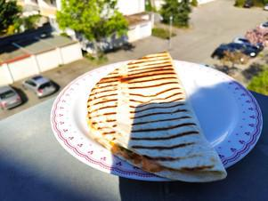

# Gochujang - Quesadillas

## Ingredients

- 2 große Weizentortillas
- grob 200g gouda
- 70g frischkäse
- 1tl gochujang
- 1 rote zwiebel
- 1 paprika
- evtl mais

### Für den Dip
- Joghurt
- Cafe de paris

## Instructions

1. Geriffelte Gusseisenplatte auf den Grill legen und gut vorheizen.
2. Zwiebeln in feine scheiben schneiden, abgedeckt für eine Minute in die Mikrowelle.
3. Paprika in kleine Würfel schneiden und kurz in einer Pfanne anbraten.
4. Gouda reiben. Frischkäse, Gouda, Gochujang plus das Gemüse in einer Schüssel zu einer Masse verrühren. Je nach Bedarf mit Salz und Chilipulver nachwürzen.
5. Die Masse auf den beiden Tortillas verteilen. Jeweils nur auf einer hälfte der Fläche verteilen. Wenn Masse verteilt ist, die leere Hälfte auf die Masse falten und gut drücken.
6. Die gefüllten Tortillas auf der geölten Platte für jeweils 1-2 pro Seite anbraten. Enjoy!
