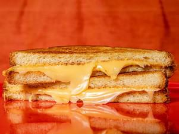

# Grilled Cheese Sandwich

## Ingredients

- 2 tablespoons ( 30 g) butter, cut into 3 even pieces
- 2 slices hearty white bread, such as Pepperidge Farm or Arnold
- 2 to 4 slices American, cheddar, or Jack cheese
- Kosher salt

## Instructions

1. In a 10-inch nonstick skillet, melt 1 piece of butter over medium heat until foaming subsides. Add both bread slices and cook, swirling occasionally, until pale golden brown on bottom sides, about 2 minutes.
2. Transfer bread to a work surface, toasted side up. Place cheese slices on top of one slice, then close sandwich, with both toasted sides facing inward.
3. Add 1 piece of butter to skillet, reduce heat to medium-low, and cook until melted. Add sandwich and cook, swirling occasionally and pressing with your hand or a cooking weight, until deep, even golden brown, about 5 minutes. Using a flexible spatula, transfer sandwich to work surface. Add remaining butter to skillet, cook until melted, then return sandwich to skillet, toasted side up. Season with salt. Cook, swirling occasionally, until second side is deep, even golden brown and cheese is thoroughly melted, about 5 minutes; if cheese isn't fully melted, cover skillet and continue to cook until cheese is melted. Serve immediately.

## Notes

Serve with tomato soup.
