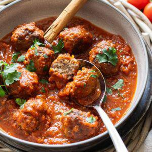

# Hackbällchen in Tomatensoße

## Ingredients

### Für die Hackbällchen
- 300 g gemischtes Hackfleisch gerne in Bio-Qualität
- ½ große rote Zwiebel (Rest = für die Tomatensoße)
- 1 Knoblauchzehe
- 2 Eier, Gr. M
- 30 g Semmelbrösel = 2 gehäufte EL
- 1 Prise Chilipulver
- 10 g Parmesan = 2 gehäufte EL
- 1 TL Abrieb einer Bio-Zitrone
- TL Salz & frisch gemahlener Pfeffer
- EL Öl zum Braten z.B. Sonnenblumen- oder Erdnussöl

### Für die Tomatensoße
- ½ rote Zwiebel
- 1 Knoblauchzehe
- 1 EL Olivenöl
- 1 EL Tomatenmark
- 400 g passierte Tomaten
- 100 ml Hühnerbrühe
- 1 Prise Zucker
- 1 TL Balsamico-Essig
- ½ Zimtrinde
- 1 TL Zitronensaft
- 1 Prise Chiliflocken (optional)
- Salz, frisch gemahlener Pfeffer
- EL Oregano getrocknet

### Zum Anrichten
- etwas frische Petersilie
- EL Pinienkerne geröstet
- Kochmodus Klick hier und dein Bildschirm bleibt an (Button = rot)

## Instructions
