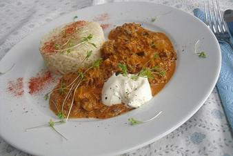

# Hackfleisch Nach Russischer Art

## Ingredients

- 3 Zwiebel(n), große, gewürfelt
- 2 EL Öl
- 1 EL Butterschmalz
- 1 Packung Jackfruit Hack
- 1 Stange/n Porree
- 3 EL Tomatenmark
- 1 EL Senf
- 250 ml Brühe
- 2 TL Paprikapulver, edelsüß
- 1 TL Salz
- 250 ml saure Sahne

## Instructions

1. Zwiebeln im heißen Fett anbraten. Dann das Hack zufügen und krümelig braten. Den gewaschenen und in Streifen geschnittenen Porree und alle Zutaten außer der Sahne zufügen und 20 Min. dünsten. Die Saure Sahne zufügen.

## Notes

Dazu passt am besten Reis oder Brot.
