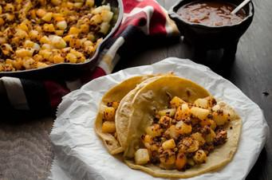

# Homemade Vegan Chorizo

## Ingredients

- 1 block (12 oz.) Tofu, extra firm
- ½ lb. Mushrooms, finely chopped
- 6 Chile guajillo, dried, seeded
- 2 Chile ancho, dried, seeded
- 4 Chile de arbol, dried
- 4 cloves Garlic
- 1 tbsp. Oregano, dried
- ½ tsp. Cumin, ground
- 2 Cloves, whole
- 1 tbsp. Paprika, ground
- ½ tsp. Coriander, ground
- ¼ cup Apple cider vinegar
- 2 tbsp. Vegetable oil, optional

## Instructions

1. Remove tofu from package and place in between two small plates. Place a can on top of the plates and leave like this for 30 min.
2. Bring a small pot of water to a boil. Remove the stems and seeds from the chiles and discard them. Drop the chiles into the boiling water. Turn heat down to the lowest setting and let the chiles sit in the water for 10 min.
3. Remove the chiles from the water and place in blender. Reserve ½ cup of the chile soaking liquid.
4. Add the garlic, oregano, cumin, cloves, paprika, coriander, apple cider vinegar, and ¼ cup of soaking liquid to the blender and process until smooth. If necessary add the remaining ¼ cup of the soaking liquid to get things moving in the blender.
5. Season the chile mixture with salt and pepper and pass through a fine strainer. Set aside.
6. Drain the water from the tofu and crumble with your hands into a large bowl. Pour half of the pureed chile mixture into the bowl with the tofu and stir to combine. Set aside.
7. Heat a large sauté pan to high heat and add 1 tbsp. of oil. Once the oil is hot add the finely chopped mushrooms and continue to cook until the mushrooms begin to brown, about 6-7 min.
8. Lower heat to medium-low and pour in the remaining half of the chile mixture. Stir and continue to cook for 3-4 minutes, until the mushrooms begin to absorb the chile mixture. Remove from pan and place in a large bowl.
9. Heat a non-stick sauté pan set to medium heat, add 1 tbsp. of oil. Add the tofu mixture and continue to cook until the liquid begins to evaporate and tofu becomes crispy, 7-8 minutes. You can make the tofu as crispy as you like. (Be careful not to overcrowd the pan or the tofu will never get crispy.)
10. Pour cooked tofu mixture into the bowl with the mushrooms and mix well to combine. Adjust seasoning.

## Notes

The finished chorizo will keep in your fridge for 3- 5 days, or you can freeze for up to 3 months. You can add it to your tofu scramble, tacos, tortas, sopes, etc. To increase the spiciness add more chile de arbol.
