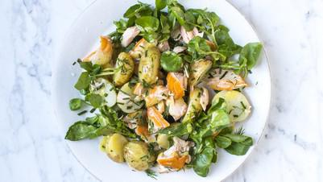

# Hot Smoked Salmon Potato Salad

## Ingredients

- 600 g new potatoes
- 6 free range eggs
- 4 hot-smoked salmon fillets (about 300 g), flaked
- Small bunch of dill, chopped
- Small bunch of chives, snipped
- Feldsalat
- ½ red onion, thinly sliced
- Good squeeze of lemon juice
- 1 tsp Dijon mustard
- 2 tsp white wine vinegar
- 3 tbsp extra-virgin olive oil
- Sea salt and black pepper

## Instructions

1. Put the potatoes into a large saucepan of salted water. Bring to the boil and simmer gently for 10-15 minutes until just tender. Seven minutes before the end of cooking time, add the eggs to this. Once cooked, remove the eggs to a bowl of ice water, drain the potatoes and allow to cool a little before slicing the potatoes in half and placing them in a large bowl.
2. Whisk together the mustard, vinegar and olive oil in a small bowl. Season generously to taste. Crack the eggs all over with the back of a teaspoon and then peel. Slice these in half lengthways.
3. Massage the baby kale in a bowl with 1 tbsp of olive oil and season. Add the warm potatoes and pour over the dressing. Add the flaked salmon, red onion, dill and chives and mix well. Add the mixed leaves, squeeze over some lemon juice and toss gently through. Place an egg on top of each portion and serve straight away.
