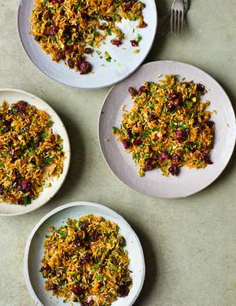

# Jewelled Herb & Rice Salad

## Ingredients

- 250g (1¼ cups) basmati rice
- 2 tbsp olive oil
- 30g (1oz) unsalted butter
- 2 small onions, finely chopped
- 1 tsp ras el hanout
- 2 carrots, grated
- pinch of saffron threads, soaked in 3 tbsp hot water
- 200g (7oz) mixed dried fruit such as sultanas, dried barberries or cranberries
- 75g (½ cup) shelled pistachios, roughly chopped
- handful of chopped mint leaves
- handful of chopped flat-leaf parsley

## Instructions

1. If you have soaked your rice, drain and give it a final rinse; if not, rinse well in a colander under the cold tap.
2. Heat the oil and butter in a sauté pan with a lid, add the onions and ras el hanout and fry over a medium heat for 5 minutes until softened. Add the drained rice, carrots and saffron (with its soaking water), then cover with 300ml (1¼ cups) cold water.
3. Season with salt and pepper, stir and bring to the boil. Cover with the lid, reduce the heat and simmer gently for 12–15 minutes, then turn off the heat and leave to stand with the lid on for 5 minutes.
4. Fluff up the rice with a fork, stir in the dried fruit, pistachios and herbs and serve.
