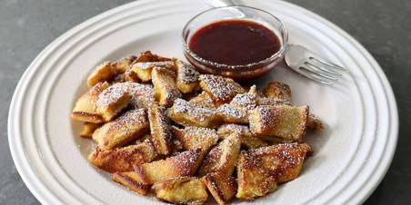

# Kaiserschmarrn

## Ingredients

- 2 large eggs, separated
- 2/3 cup all-purpose flour
- 6 tablespoons milk
- 4 teaspoons white sugar, divided
- 1/2 teaspoon vanilla extract
- 1/4 teaspoon salt
- 1/4 teaspoon lemon juice
- 2 tablespoons unsalted butter, divided
- 1 teaspoon powdered sugar for dusting (optional)

## Instructions

1. Combine egg yolks, flour, milk, 2 teaspoons white sugar, vanilla extract, and salt in a bowl; whisk until batter is smooth.
2. Combine egg whites and lemon juice in a glass, metal, or ceramic bowl and beat until soft peaks form. Add egg whites to yolk mixture and carefully fold in using a spatula until just combined, using as light a touch as possible.
3. Melt 1 tablespoon butter in a non-stick pan over medium heat. Transfer batter into the hot pan, cover, and cook until the bottom is golden brown and bubbles appear on the surface, about 4 minutes.
4. Use a spatula to cut the pancake into 4 sections and flip over. Cover and cook for another minute. Use 2 spatulas to tear or cut the pancake into 1 to 2 inch pieces.
5. Add remaining butter in little pieces to the pan and sprinkle with remaining 2 teaspoons white sugar. Cook tossing and stirring for a few minutes until pancake pieces are lightly caramelized at the edges.
6. Serve immediately, dusted with powdered sugar.
