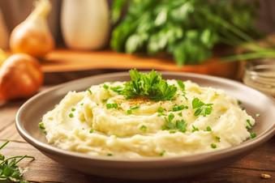

# Kartoffelpü

## Ingredients

- 1 kg Kartoffel(n), mehlig kochend
- ¼ Liter Milch, heiß, ca.
- Butter
- Salz
- Muskat

## Instructions

1. Die Kartoffeln waschen, schälen, in kleine Stücke schneiden, nochmals abspülen. Dann in kochendes Salzwasser geben und ca. 20 Min. garen. Wenn die Kartoffeln gar sind, über ein Sieb abgießen.
2. Nun die Milch aufkochen lassen. In der Zwischenzeit die Kartoffeln durchpressen, dann mit der kochenden Milch (die Menge, die gebraucht wird, hängt von der Kartoffelsorte ab) und dem Stück Butter sofort abschlagen. Mit Salz und, wer mag, mit Muskat würzen und sofort servieren.
